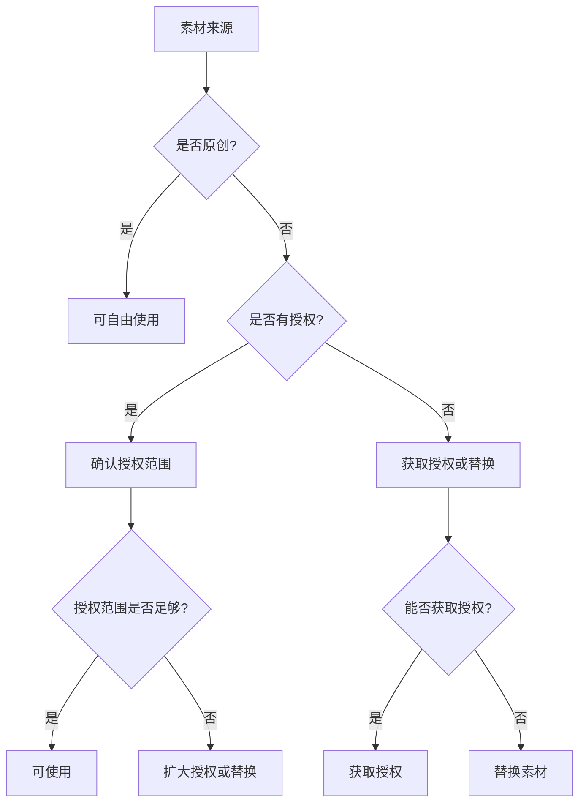

# Brand Safety Skill（品牌安全技能）

## 概述

本技能为 Compliance Officer 提供品牌安全审核的知识库和检查清单，覆盖广告主红线、版权规则、品牌声誉风险评估和竞品引用规范四大维度。

---

## 一、广告主红线清单

### 1.1 暴力内容

| 风险等级 | 内容类型 | 具体示例 | 处理方式 |
|---------|---------|---------|---------|
| P0 | 极度暴力 | 血腥肢解、酷刑展示 | 立即否决 |
| P0 | 暴力威胁 | 真实暴力威胁、武器展示 | 立即否决 |
| P1 | 明显暴力 | 打斗、流血、受伤 | 要求修改 |
| P2 | 轻微暴力 | 推搡、轻微冲突 | 建议修改 |

**检查清单：**
- [ ] 是否有血腥或肢解场景？
- [ ] 是否有真实的暴力威胁？
- [ ] 是否有武器的详细展示？
- [ ] 是否有酷刑或虐待场景？
- [ ] 是否有暴力的美化或鼓励？

### 1.2 色情与性内容

| 风险等级 | 内容类型 | 具体示例 | 处理方式 |
|---------|---------|---------|---------|
| P0 | 色情内容 | 明确的性行为展示 | 立即否决 |
| P0 | 儿童色情 | 任何涉及儿童的性内容 | 立即否决 |
| P1 | 性暗示 | 暧昧场景、挑逗动作 | 要求修改 |
| P2 | 轻微性暗示 | 性感着装、暧昧台词 | 建议修改 |

**检查清单：**
- [ ] 是否有明确的性行为展示？
- [ ] 是否有涉及儿童的性内容？
- [ ] 是否有过度的性暗示？
- [ ] 是否有不当的裸露？
- [ ] 是否有性交易的暗示？

### 1.3 政治内容

| 风险等级 | 内容类型 | 具体示例 | 处理方式 |
|---------|---------|---------|---------|
| P0 | 政治煽动 | 煽动暴力、颠覆政权 | 立即否决 |
| P0 | 政治敏感 | 涉及领土争议、政治人物 | 立即否决 |
| P1 | 政治倾向 | 明确支持某政治派别 | 要求修改 |
| P2 | 政治隐喻 | 隐含的政治评论 | 建议修改 |

**检查清单：**
- [ ] 是否有政治煽动内容？
- [ ] 是否涉及领土争议？
- [ ] 是否有明确的政治倾向？
- [ ] 是否有政治人物的戏谑？
- [ ] 是否有政治隐喻？

### 1.4 争议话题

| 风险等级 | 内容类型 | 具体示例 | 处理方式 |
|---------|---------|---------|---------|
| P0 | 极端争议 | 种族灭绝否认、恐怖主义美化 | 立即否决 |
| P1 | 高度争议 | 堕胎、安乐死、枪支管制 | 要求修改 |
| P2 | 中度争议 | 环保、动物权利、移民 | 建议修改 |

**检查清单：**
- [ ] 是否涉及极端争议话题？
- [ ] 是否有高度争议话题的明确立场？
- [ ] 是否有中度争议话题的偏向性？
- [ ] 是否有争议话题的不当处理？

### 1.5 健康与安全

| 风险等级 | 内容类型 | 具体示例 | 处理方式 |
|---------|---------|---------|---------|
| P0 | 危险行为 | 自残、自杀、危险挑战 | 立即否决 |
| P0 | 健康误导 | 虚假医疗声明、反疫苗宣传 | 立即否决 |
| P1 | 危险示范 | 危险运动、极限挑战 | 要求修改 |
| P2 | 健康不当 | 不健康生活方式的美化 | 建议修改 |

**检查清单：**
- [ ] 是否有自残或自杀内容？
- [ ] 是否有危险挑战或行为？
- [ ] 是否有虚假医疗声明？
- [ ] 是否有反科学的健康误导？
- [ ] 是否有危险行为的美化？

---

## 二、版权规则

### 2.1 音乐版权

| 类型 | 版权状态 | 使用限制 | 检查方法 |
|------|---------|---------|---------|
| 流行歌曲 | 有版权 | 需获得授权 | 查询版权数据库 |
| 古典音乐 | 版权复杂 | 录音有版权，曲谱可能无版权 | 确认录音版权 |
| 免费音乐 | 无版权 | 需确认授权范围 | 检查授权协议 |
| 原创音乐 | 无版权 | 可自由使用 | 确认原创性 |

**音乐版权检查清单：**
- [ ] 是否使用了有版权的流行歌曲？
- [ ] 是否确认了音乐的授权范围？
- [ ] 是否有音乐署名要求？
- [ ] 是否有音乐的地域使用限制？
- [ ] 是否有音乐的商业使用限制？

**音乐版权解决方案：**
1. 使用免费音乐库（如 Epidemic Sound, Artlist）
2. 购买音乐授权
3. 使用原创音乐
4. 使用公共领域音乐

### 2.2 图片版权

| 类型 | 版权状态 | 使用限制 | 检查方法 |
|------|---------|---------|---------|
| 专业摄影 | 有版权 | 需获得授权 | 查询版权数据库 |
| 免费图片 | 无版权 | 需确认授权范围 | 检查授权协议 |
| 用户生成 | 版权复杂 | 需获得用户授权 | 确认用户授权 |
| AI 生成 | 版权不确定 | 需确认生成工具政策 | 检查工具政策 |

**图片版权检查清单：**
- [ ] 是否使用了有版权的图片？
- [ ] 是否有图片中的人物授权？
- [ ] 是否有图片中的品牌标识？
- [ ] 是否有图片中的商标？
- [ ] 是否确认了图片的授权范围？

**图片版权解决方案：**
1. 使用免费图片库（如 Unsplash, Pexels）
2. 购买图片授权
3. 使用原创图片
4. 使用 AI 生成图片（需确认政策）

### 2.3 视频素材版权

| 类型 | 版权状态 | 使用限制 | 检查方法 |
|------|---------|---------|---------|
| 电影片段 | 有版权 | 需获得授权 | 查询版权数据库 |
| 电视剧片段 | 有版权 | 需获得授权 | 查询版权数据库 |
| 免费视频 | 无版权 | 需确认授权范围 | 检查授权协议 |
| 用户生成 | 版权复杂 | 需获得用户授权 | 确认用户授权 |

**视频素材版权检查清单：**
- [ ] 是否使用了有版权的电影/电视剧片段？
- [ ] 是否有视频中的人物授权？
- [ ] 是否有视频中的品牌标识？
- [ ] 是否有视频中的商标？
- [ ] 是否确认了视频的授权范围？

**视频素材版权解决方案：**
1. 使用免费视频库（如 Pexels, Pixabay）
2. 购买视频授权
3. 使用原创视频
4. 使用 AI 生成视频

### 2.4 字体版权

| 类型 | 版权状态 | 使用限制 | 检查方法 |
|------|---------|---------|---------|
| 商业字体 | 有版权 | 需购买授权 | 查询字体厂商 |
| 免费字体 | 无版权 | 需确认授权范围 | 检查授权协议 |
| 系统字体 | 复杂 | 需确认系统授权 | 检查系统授权 |

**字体版权检查清单：**
- [ ] 是否使用了有版权的商业字体？
- [ ] 是否确认了字体的授权范围？
- [ ] 是否有字体的商业使用限制？
- [ ] 是否有字体的嵌入限制？

**字体版权解决方案：**
1. 使用免费字体（如 Google Fonts）
2. 购买字体授权
3. 使用系统默认字体
4. 使用开源字体

### 2.5 版权检查流程



---

## 三、品牌声誉风险评估标准

### 3.1 风险评估矩阵

| 风险维度 | 低风险 (1分) | 中风险 (2分) | 高风险 (3分) | 极高风险 (4分) |
|---------|------------|------------|------------|--------------|
| 内容合规 | 完全合规 | 轻微违规 | 明显违规 | 严重违规 |
| 舆论风险 | 无争议 | 轻微争议 | 明显争议 | 极度争议 |
| 法律风险 | 无风险 | 低风险 | 中风险 | 高风险 |
| 品牌关联 | 正面关联 | 中性关联 | 负面关联 | 严重负面 |
| 传播风险 | 低传播 | 中传播 | 高传播 | 病毒式传播 |

### 3.2 风险等级划分

| 总分 | 风险等级 | 处理建议 |
|------|---------|---------|
| 5-8 | 低风险 | 可正常发布 |
| 9-12 | 中风险 | 需要审核后发布 |
| 13-16 | 高风险 | 需要修改后发布 |
| 17-20 | 极高风险 | 不建议发布 |

### 3.3 品牌声誉风险检查清单

#### 内容层面
- [ ] 是否有违反平台政策的内容？
- [ ] 是否有违反法律法规的内容？
- [ ] 是否有道德争议的内容？
- [ ] 是否有文化冒犯的内容？

#### 舆论层面
- [ ] 是否可能引发负面舆论？
- [ ] 是否可能被断章取义？
- [ ] 是否可能被恶意利用？
- [ ] 是否可能引发抵制？

#### 法律层面
- [ ] 是否有版权侵权风险？
- [ ] 是否有商标侵权风险？
- [ ] 是否有隐私侵权风险？
- [ ] 是否有诽谤风险？

#### 品牌层面
- [ ] 是否与品牌形象一致？
- [ ] 是否与品牌价值观一致？
- [ ] 是否可能损害品牌声誉？
- [ ] 是否可能影响品牌合作？

### 3.4 危机预警信号

| 信号类型 | 具体表现 | 处理建议 |
|---------|---------|---------|
| 舆论预警 | 社交媒体负面评论激增 | 立即评估，准备回应 |
| 法律预警 | 收到律师函或投诉 | 立即法务评估 |
| 平台预警 | 平台发出警告或限流 | 立即修改内容 |
| 合作方预警 | 合作方提出担忧 | 立即沟通，评估影响 |

---

## 四、竞品引用规范

### 4.1 竞品引用原则

| 原则 | 说明 | 违反后果 |
|------|------|---------|
| 真实性 | 引用内容必须真实准确 | 可能构成虚假宣传 |
| 公正性 | 不得恶意贬低竞品 | 可能构成不正当竞争 |
| 合法性 | 不得侵犯竞品知识产权 | 可能构成侵权 |
| 适度性 | 引用必须适度，不得过度 | 可能引发法律纠纷 |

### 4.2 竞品引用检查清单

#### 真实性检查
- [ ] 引用的竞品信息是否真实？
- [ ] 引用的数据是否有来源？
- [ ] 引用的比较是否客观？
- [ ] 是否有断章取义的情况？

#### 公正性检查
- [ ] 是否有恶意贬低竞品的内容？
- [ ] 是否有误导性的比较？
- [ ] 是否有不公平的评价？
- [ ] 是否有诋毁竞品的言论？

#### 合法性检查
- [ ] 是否使用了竞品的商标？
- [ ] 是否使用了竞品的 Logo？
- [ ] 是否使用了竞品的版权内容？
- [ ] 是否有商标侵权风险？

#### 适度性检查
- [ ] 竞品引用是否过度？
- [ ] 是否有借竞品营销的嫌疑？
- [ ] 是否有蹭竞品热度的嫌疑？
- [ ] 是否有利用竞品声誉的嫌疑？

### 4.3 竞品引用风险等级

| 风险等级 | 内容类型 | 处理方式 |
|---------|---------|---------|
| P0 | 恶意诋毁竞品、虚假宣传 | 立即否决 |
| P1 | 不公平比较、误导性引用 | 要求修改 |
| P2 | 过度引用、轻微不当 | 建议修改 |

### 4.4 竞品引用最佳实践

**可以做的：**
- 客观比较产品功能
- 引用公开的市场数据
- 使用"行业领先"等中性描述
- 引用第三方评测结果

**不可以做的：**
- 使用竞品商标或 Logo
- 恶意贬低竞品产品
- 虚假宣传竞品缺点
- 借竞品名义进行营销

---

## 五、品牌安全审核报告模板

```markdown
# 品牌安全审核报告

## 基本信息
- 审核日期：[日期]
- 审核人：Compliance Officer
- 审核内容：[内容描述]
- 目标品牌：[品牌名称]

## 广告主红线检查

### P0 级（立即否决）
| # | 问题描述 | 红线类型 | 位置 | 建议 |
|---|---------|---------|------|------|
| 1 | [问题] | [类型] | [位置] | [建议] |

### P1 级（要求修改）
| # | 问题描述 | 红线类型 | 位置 | 建议 |
|---|---------|---------|------|------|
| 1 | [问题] | [类型] | [位置] | [建议] |

### P2 级（建议修改）
| # | 问题描述 | 红线类型 | 位置 | 建议 |
|---|---------|---------|------|------|
| 1 | [问题] | [类型] | [位置] | [建议] |

## 版权检查

| 素材类型 | 数量 | 是否有授权 | 备注 |
|---------|------|-----------|------|
| 音乐 | [数量] | ✅/❌ | [备注] |
| 图片 | [数量] | ✅/❌ | [备注] |
| 视频 | [数量] | ✅/❌ | [备注] |
| 字体 | [数量] | ✅/❌ | [备注] |

## 品牌声誉风险评估

| 风险维度 | 评分 | 说明 |
|---------|------|------|
| 内容合规 | [分数] | [说明] |
| 舆论风险 | [分数] | [说明] |
| 法律风险 | [分数] | [说明] |
| 品牌关联 | [分数] | [说明] |
| 传播风险 | [分数] | [说明] |
| **总分** | [总分] | [风险等级] |

## 竞品引用检查

| 检查项 | 是否通过 | 备注 |
|--------|---------|------|
| 真实性 | ✅/❌ | [备注] |
| 公正性 | ✅/❌ | [备注] |
| 合法性 | ✅/❌ | [备注] |
| 适度性 | ✅/❌ | [备注] |

## 审核结论
- [ ] 通过
- [ ] 需修改后重审
- [ ] 否决（P0 违规）

## 修改要求
1. [修改要求 1]
2. [修改要求 2]
```

---

## 六、常见品牌安全问题速查

| 问题类型 | 常见场景 | 风险等级 | 处理建议 |
|---------|---------|---------|---------|
| 版权音乐 | 使用流行歌曲作为 BGM | P1 | 替换为授权音乐 |
| 品牌标识 | 无意中展示竞品 Logo | P2 | 模糊或移除 |
| 暴力内容 | 打斗场景过于血腥 | P1 | 修改或删除场景 |
| 色情暗示 | 性感着装或暧昧台词 | P1 | 修改着装或台词 |
| 政治敏感 | 涉及政治话题 | P0 | 移除相关内容 |
| 健康误导 | 虚假医疗声明 | P0 | 移除相关内容 |
| 竞品诋毁 | 恶意贬低竞品 | P0 | 移除相关内容 |
| 隐私泄露 | 展示他人隐私信息 | P0 | 移除相关内容 |
